# Rolling Date Slicer for Power BI


A date slicer for Power BI with a **default date range that moves forward every day**. Set it to "Last 30 days" once, and every time anyone opens the report, it shows the last 30 days counted from that day.

It looks and works like the built-in slicer: Between, Before, After, Vertical list, Tile, Dropdown, Relative date and Date picker. It is English-only and uses the Gregorian calendar.

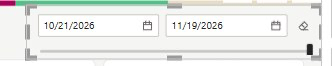

**Download:** [`release/RollingDateSlicer-1.0.0.0.pbiviz`](release/RollingDateSlicer-1.0.0.0.pbiviz)
&nbsp;·&nbsp; **Word guide:** [`docs/Rolling Date Slicer - User Guide.docx`](docs/Rolling%20Date%20Slicer%20-%20User%20Guide.docx)

---

## Contents

1. [Why this slicer](#1-why-this-slicer)
2. [Install and add to a report](#2-install-and-add-to-a-report)
3. [The rolling default range](#3-the-rolling-default-range)
4. [Slicer styles](#4-slicer-styles)
5. [Format settings](#5-format-settings)
6. [Picking dates](#6-picking-dates)
7. [Tips and limits](#7-tips-and-limits)
8. [Build from source](#8-build-from-source)

---

## 1. Why this slicer

The built-in **Between**, **List** and **Dropdown** slicers remember the exact dates selected when the report was saved. Suppose you save a report on 1 November with "last 30 days" selected. A month later it still shows 2–31 October. The built-in **Relative date** slicer does roll, but it can't show the dates as a slider, a list or a tree.

Rolling Date Slicer combines the two:

- **Rolling default range.** You choose a rule such as *Last 30 days*. It is recalculated for today every time the report opens, and again at midnight if the report stays open.
- **Every slicer style:** Between with a slider, Before, After, Vertical list, Tile, Dropdown, Relative date and Date picker.
- **Trees.** List and Dropdown can show Year › Month › Day, Year › Quarter › Month › Day, or Year › ISO week › Day. The default range is ticked automatically, however long it is.
- **Save user changes, or not.** Either a user's own selection is kept, or the default comes back the next time the report opens.
- **Native look:** date boxes, bar handles, header, borders, fonts and colours like the built-in slicer, with every part optional.

## 2. Install and add to a report

### 2.1 Import the visual

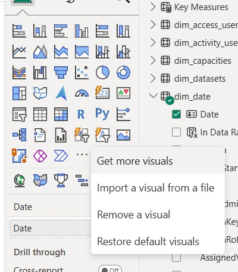

1. In Power BI Desktop, open the **Visualizations** pane.
2. Click **…** (More) under the visual icons.
3. Choose **Import a visual from a file**.
4. Select `RollingDateSlicer-1.0.0.0.pbiviz` and confirm.

The new icon, a slicer with a calendar, appears at the end of the visual list.

<br clear="right">

### 2.2 Add it to the page

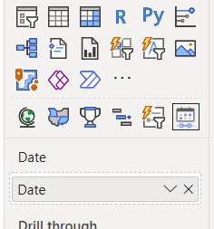

1. Click the Rolling Date Slicer icon to place it on the page.
2. Drag a **date column** (for example `dim_date › Date`) into the **Date** well.
3. Resize and move the visual like any other visual.

Use a real Date or Date/Time column. A table marked as a date table works best.

<br clear="right">

### 2.3 Where the settings are

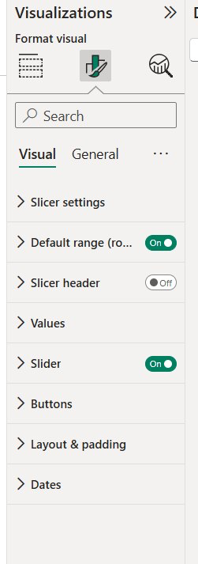

Select the visual and open **Format visual** (the paint brush). All settings are on the **Visual** tab:

| Card | What it controls |
|---|---|
| Slicer settings | Style, and what each style shows |
| Default range (rolling) | The rolling default |
| Slicer header | Title, border, background |
| Values | Fonts, colours, date boxes |
| Slider | Handles, selected range, track |
| Buttons | Reset and clear buttons |
| Layout & padding | Spacing and position |
| Dates | Date format, week start |

Options that don't apply to the chosen style are hidden. Each card has **Reset to default** at the bottom.

<br clear="right">

## 3. The rolling default range

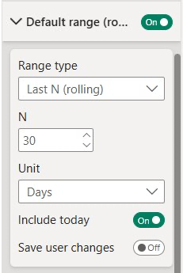

Switch the **Default range (rolling)** card **On** and set:

- **Range type:** how the range is counted (see the table below).
- **N:** how many units. There is no upper limit.
- **Unit:** Days, Weeks, Months, Quarters or Years.
- **Include today:** whether today counts as part of the range.
- **Save user changes:** see [3.2](#32-save-user-changes).

With Last N (rolling), N = 30, Days and Include today on, opening the report on 19 Nov 2026 selects **21 Oct – 19 Nov 2026**. Opening it the next day selects 22 Oct – 20 Nov.

<br clear="right">

### 3.1 Range types

These examples are for a report opened on **Thursday 19 November 2026**, with Include today on.

| Range type | Meaning | Example | Result |
|---|---|---|---|
| Last N (rolling) | N units ending today | 30 Days | 21 Oct – 19 Nov 2026 |
| Last N (rolling) | | 3 Months | 20 Aug – 19 Nov 2026 |
| Last N calendar (complete periods) | The N full periods before the current one. With Include today, the current period so far is added. | 3 Months, Include today off | 1 Aug – 31 Oct 2026 |
| This period (whole) | The whole current period, including future days | Month | 1 Nov – 30 Nov 2026 |
| Period to date | From the start of the current period up to today | Year | 1 Jan – 19 Nov 2026 |
| Next N | N units starting today | 7 Days | 19 Nov – 25 Nov 2026 |

Weeks start on the day chosen in **Dates › Week starts on**. The range is always worked out from the viewer's local date.

### 3.2 Save user changes

| Save user changes | What happens when a user picks other dates |
|---|---|
| **Off** (default) | The user's dates apply while they work. The next time the report opens, today's default comes back, so nobody has to reset it by hand. |
| **On** | The user's own selection is kept (for example in a saved or published report). If the slicer is still on the default, the default keeps rolling every day. |

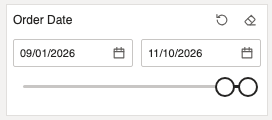

> **Tip:** the **Reset to default** button (circular arrow) appears as soon as a user changes the dates. One click returns to today's default. The **eraser** clears the filter so all dates are shown.

<br clear="right">

### 3.3 Trees and lists

In the Vertical list, Tile and Dropdown styles, the default range is ticked automatically each time the report opens, however many months it covers. The tree opens the years, months or weeks where the range starts and ends, so the edges are visible. Partly selected nodes show a half-filled box.

## 4. Slicer styles

Choose the style in **Slicer settings › Style**. The rolling default works in every style.

| Style | What the user sees |
|---|---|
| **Between** | Start and end date boxes plus a slider (default) |
| **Before** | One date box: everything up to that date |
| **After** | One date box: everything from that date on |
| **Vertical list** | A searchable list or tree of dates with check boxes |
| **Tile** | Buttons for months, years or days |
| **Dropdown** | The list or tree inside a dropdown |
| **Relative date** | "Last / Next / This", a number and a unit |
| **Date picker** | A quick-range menu (Default, Today, Yesterday, Last 7/30/90 days, This week, This month, Last month, This quarter, Year to date, Last 12 months, All dates, Custom range) above the date boxes |

| | |
|---|---|
| 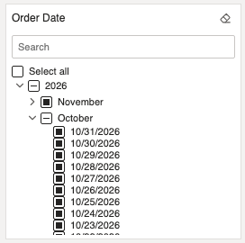<br>Vertical list: Year › Month › Day tree | 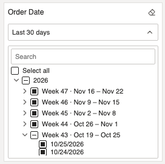<br>Dropdown: Year › ISO week › Day tree |
| 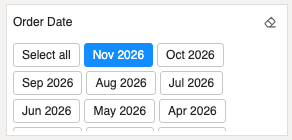<br>Tile (months) | 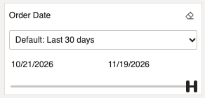<br>Date picker with quick ranges |
| 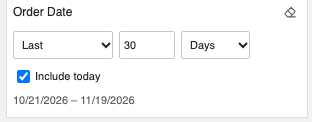<br>Relative date | 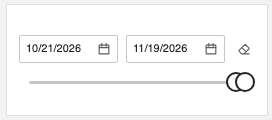<br>Header off, padding 12, Middle |

<sub>These example images were rendered outside Power BI. Colours and handles follow your Format settings.</sub>

## 5. Format settings

### 5.1 Slicer settings

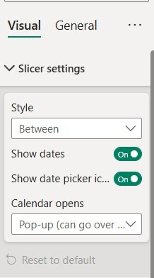

| Setting | What it does | Default |
|---|---|---|
| Style | One of the eight styles above | Between |
| Show dates | Date boxes above the slider | On |
| Show date picker icon | Calendar icon in each box. Without it, users can still type a date. | On |
| Calendar opens | Pop-up or Inside the visual (see [6](#6-picking-dates)) | Pop-up |
| Show default-range label | A label such as "Last 30 days", or "Custom selection" after a change | Off |
| Label position | In the header, or in front of the dates (always in front when the header is off) | In the header |
| View | List/Dropdown: Tree (Year › Month › Day), Tree (Year › ISO week › Day), Days, Months, Years | Tree |
| Show quarters | Adds a Quarter level to the month tree | Off |
| Tiles show | Months, Years or Days | Months |
| Single select | Only one item can be picked | Off |
| Show "Select all" | The Select all row in lists | On |
| Show search box | A search box above lists | On |

<br clear="right">

### 5.2 Slicer header

The switch in the card title shows or hides the whole header. When the header is off, the field name isn't shown anywhere, and the buttons and the default-range label move next to the dates.

| Setting | What it does | Default |
|---|---|---|
| Show title | Shows the title text | On |
| Title text | Your own title. Leave it empty to use the field name. | Field name |
| Font, Font color | Font family, size, bold, italic, underline and colour | Segoe UI 9 |
| Border | Colour, width, position (bottom, top, top + bottom, frame) | Off |
| Background | Colour, transparency | Off |

| | |
|---|---|
| 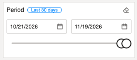<br>Custom title and default-range label | 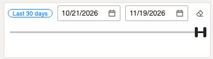<br>Header off: label in front of the dates |

### 5.3 Values

| Setting | What it does | Default |
|---|---|---|
| Font, Font color | Dates, list items and tiles | Segoe UI 9 |
| Selection color | Selected tiles, check boxes and calendar days | #118DFF |
| Look | Boxes (like the native slicer), Plain text, Underline | Boxes |
| Border color / width | Outline of the date boxes | #B3B0AD / 1 |
| Rounded corners | Corner radius of the boxes | 2 |
| Background | Fill inside the boxes, lists and pop-ups | On, white |

### 5.4 Slider

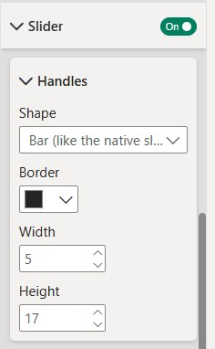

The switch in the card title shows or hides the slider.

- **Handles:** shape (Bar like the native slicer, or Circle), border and fill colours, width and height (Bar) or size (Circle).
- **Selected range:** the colour between the handles.
- **Track:** colour and thickness, and whether to show the first and last date.

When both handles are on the same date, drag left or right to pull the one you need.

<br clear="right">

### 5.5 Buttons

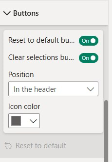

- **Reset to default button:** a circular arrow, shown only when the dates differ from the default.
- **Clear selections button (eraser):** removes the filter.
- **Position:** In the header, or next to the dates.
- **Icon color.**

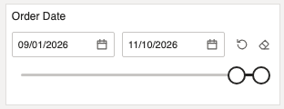

<br clear="right">

### 5.6 Layout & padding

| Setting | What it does | Default |
|---|---|---|
| Padding top / right / bottom / left | Space inside the visual's edge, in pixels | 4 / 6 / 4 / 6 |
| Vertical position | Top, Middle or Bottom | Top |
| Space between rows | Gap between the header, date boxes and slider | 8 |

### 5.7 Dates

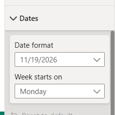

- **Date format:** 11/19/2026, 19/11/2026, Nov 19, 2026, 11/19/26, November 19, 2026, or 2026-11-19. Typed dates are read in the same order.
- **Week starts on:** Monday, Sunday or Saturday. The ISO week tree always uses Monday-to-Sunday weeks.

<br clear="right">

## 6. Picking dates

Users can type a date, drag a slider handle, or click the calendar icon.

Power BI draws each custom visual inside its own box, and nothing the visual draws itself can go past that box. That is why **Slicer settings › Calendar opens** has two options:

| Option | Good for | Trade-off |
|---|---|---|
| **Pop-up** (default) | Short slicers. The browser's own date picker opens and can go over other visuals. | Picks one date at a time, without the range highlight. Its look comes from the browser. |
| **Inside the visual** | Taller slicers. Highlights the selected range, today, and dates without data. | Must fit inside the visual, so it shrinks in a short slicer. |

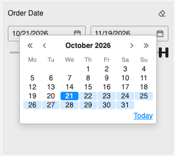

## 7. Tips and limits

- The default range is applied when the report opens and at midnight. While the report is open, users can change the dates freely.
- A bookmark that saved an old default is rolled to today's default. A bookmark with a user-chosen range keeps its range.
- Date picker quick ranges (Last 7 days, This month, …) apply fixed dates when picked. Only the Default range rolls.
- Use one Rolling Date Slicer per date column on a page.
- After importing a new version, visuals already on the page keep their saved Format settings. Use **Reset to default** on a card to pick up new defaults.
- The slicer reads up to 30,000 distinct dates.

## 8. Build from source

```bash
cd rollingDateSlicer
npm install
npm run package          # creates dist/*.pbiviz
npm run start            # dev server for Power BI's developer visual
```

| Path | Contents |
|---|---|
| `rollingDateSlicer/src/dateUtils.ts` | Date math on calendar-day numbers (no time-zone off-by-one) |
| `rollingDateSlicer/src/decide.ts` | Pure logic that decides whether to apply today's default or keep the incoming filter |
| `rollingDateSlicer/src/tree.ts` | Year › Month › Day and ISO Year › Week › Day trees |
| `rollingDateSlicer/src/settings.ts` | Format pane cards and visibility rules |
| `rollingDateSlicer/src/visual.ts` | The visual: filters and rendering |
| `rollingDateSlicer/README.md` | Developer notes and a Power BI test checklist |
| `docs/COPILOT_PROMPT.md` | A full specification you can give an AI coding assistant to rebuild the visual |

### How the default is recognised

The filter itself records where it came from. Our default is written as `>= start` and `< end + 1 day`. A user's range is written as `>= start` and `<= end 23:59:59.999`. When a report or bookmark is opened, a stale default is recognised and rolled to today, and a user's range is left alone (or replaced, when Save user changes is off).

## License

MIT
